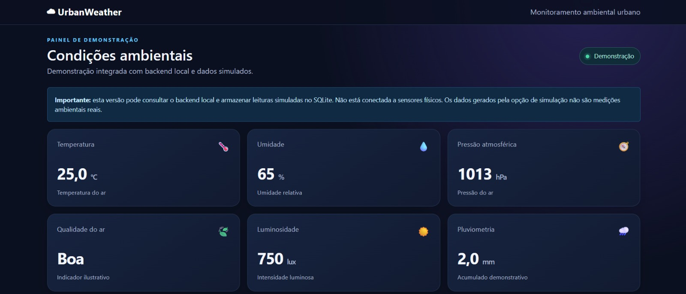
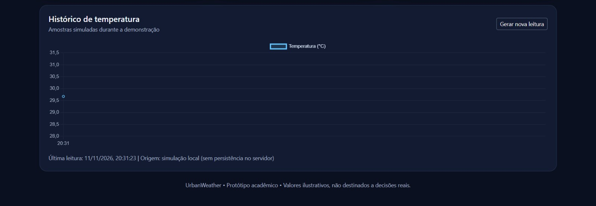

# UrbanWeather

O UrbanWeather é um projeto desenvolvido como parte de um trabalho da faculdade, com o objetivo de criar um sistema de monitoramento climático urbano.

O sistema apresenta informações ambientais, como temperatura, umidade do ar, pressão atmosférica, qualidade do ar, luminosidade e quantidade de chuva.

Através de um painel, é possível visualizar esses indicadores, gerar novas leituras simuladas e acompanhar as variações de temperatura em um gráfico atualizado automaticamente.

O projeto também possui integração com um backend local, que permite consultar e armazenar as leituras simuladas em um banco de dados SQLite.

Caso o backend não esteja disponível, o sistema utiliza dados gerados localmente para continuar demonstrando seu funcionamento.

**Tecnologias utilizadas:**
- HTML
- CSS
- JavaScript
- Bootstrap 5
- Chart.js
- SQLite (armazenamento pelo backend)

O projeto é um protótipo acadêmico e utiliza dados simulados, não realizando medições ambientais reais.
